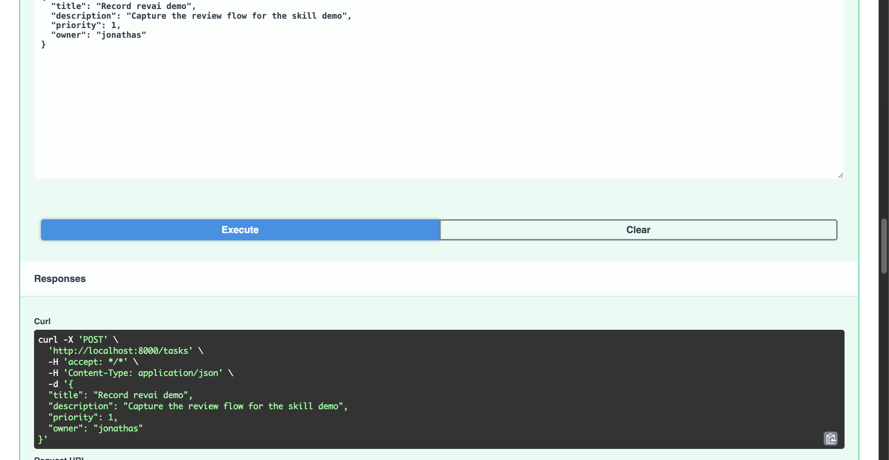
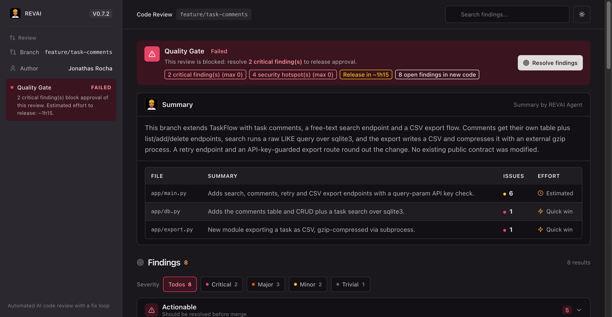
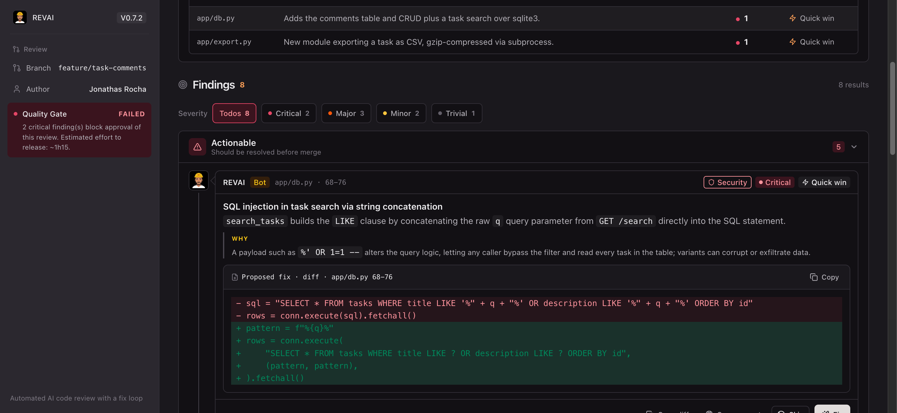
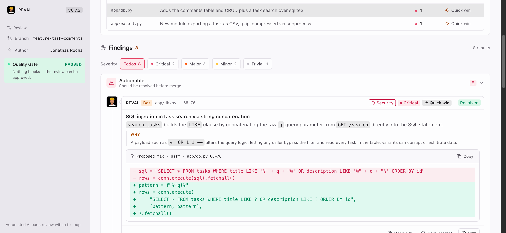
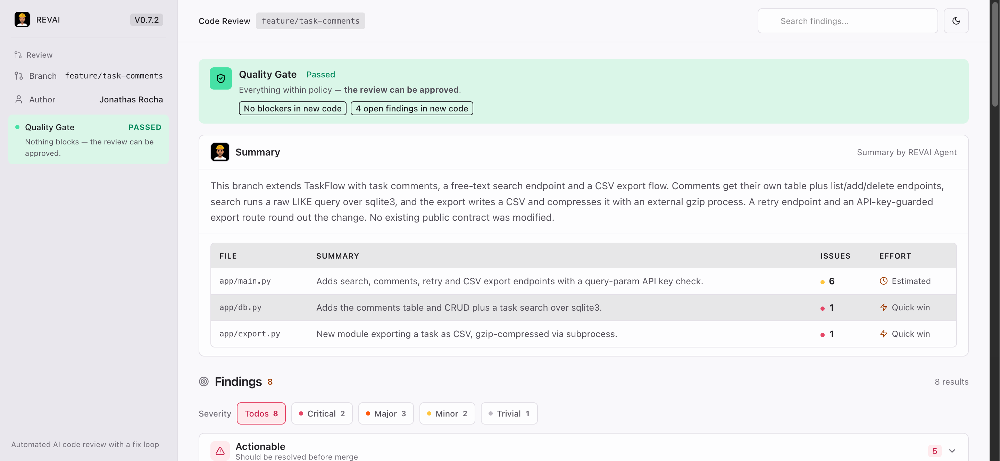
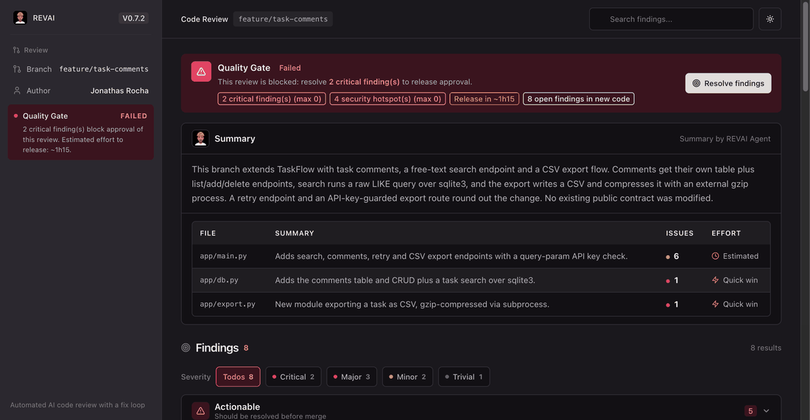
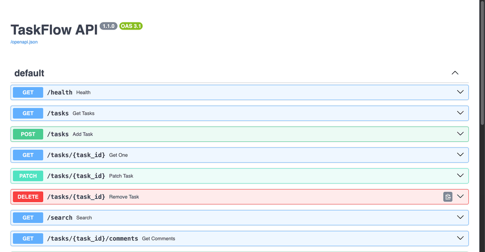

# revai demo — TaskFlow API walkthrough

This walkthrough shows revai end-to-end on a small demo project: a FastAPI +
sqlite3 task manager with a feature branch that ships a few intentionally rough
changes. The agent reviews only the changed lines, writes structured findings,
opens an interactive HTML report, then applies fixes on request until the
Quality Gate passes.

## The setup

`demo/taskflow-api` is a scratch repository with two branches:

- **`main`** — clean baseline: task CRUD over `sqlite3` with parameterized
  queries and passing tests.
- **`feature/task-comments`** — adds comments, free-text search and CSV export,
  **with 8 planted findings** (2 critical, 3 major, 2 minor, 1 trivial).

Running the demo project locally:

```bash
cd demo/taskflow-api
python3 -m venv .venv && . .venv/bin/activate
pip install -r requirements.txt
pytest tests/ -q          # 3 passed
uvicorn app.main:app --port 8000
```

Then open the Swagger UI at `http://localhost:8000/docs` — create a task, list
tasks, and the demo API is alive:



## Step 1 — Generate the review patch

From the demo project, tell your agent **"review this branch"** (or run the
skill's diff step directly):

```bash
node <skill-base>/scripts/revai.mjs diff --branch feature/task-comments
```

```text
Branch : feature/task-comments (base: main)
Files  : 3 changed
Lines  : +157 / -2
Slug   : feature-task-comments
```

The patch lands in `.revai/data/feature-task-comments.patch`.

## Step 2 — Analyze and write findings

The agent reads the patch, reviews only the `+`/`-` lines against the universal
rubric plus the backend playbook, and persists
`feature-task-comments-review.json` + `feature-task-comments-meta.json`.

What it found:

| ID | Severity | Category | Finding |
|----|----------|----------|---------|
| CR-01 | Critical | Security | SQL injection in task search (string-concatenated `LIKE` query) |
| CR-02 | Critical | Security | Command injection risk: `gzip` run with `shell=True` on an interpolated path |
| CR-03 | Major | Security | API key hardcoded in source |
| CR-04 | Major | Security | Comment deletion accepts `user_id` but never checks ownership |
| CR-05 | Major | Stability | Export failures silently swallowed (`except Exception: pass`) |
| CR-06 | Minor | Performance | Blocking `time.sleep` inside an `async` endpoint |
| CR-07 | Minor | Performance | Search endpoint returns an unbounded result set |
| CR-08 | Trivial | Stability | No tests cover the new endpoints |

## Step 3 — Generate and open the report

```bash
node <skill-base>/scripts/generate-review.mjs feature-task-comments
```

The report opens in the browser automatically. Quality Gate: **FAILED** —
2 critical findings block approval, estimated release effort ~1h15.



Every finding is interactive: filters by severity, dark/light theme, and a
"Copy prompt" button that turns any item into a fix prompt for any agent
session.



## Step 4 — The fix loop

**"fix CR-01"** — the agent applies the minimal fix (parameterize the search
query), marks the finding resolved, and regenerates the report. The Quality
Gate recalculates.



Repeating the loop for CR-02 (spawn `gzip` with an argument list instead of a
shell string), CR-03 (read the API key from the environment) and CR-04 (verify
comment ownership before deleting) clears every blocker:



## The whole loop, in motion

Report tour — gate fails, findings, filters, theme:



Fix loop — resolve findings by ID, gate recalculates, passes:


API demo — the reviewed app actually runs:



## Notes

- Review artifacts live in `demo/taskflow-api/.revai/` and are gitignored.
- Both `demo/` and `media/` are local-only in this repository (git
  `info/exclude`), so the skill repo stays clean.
